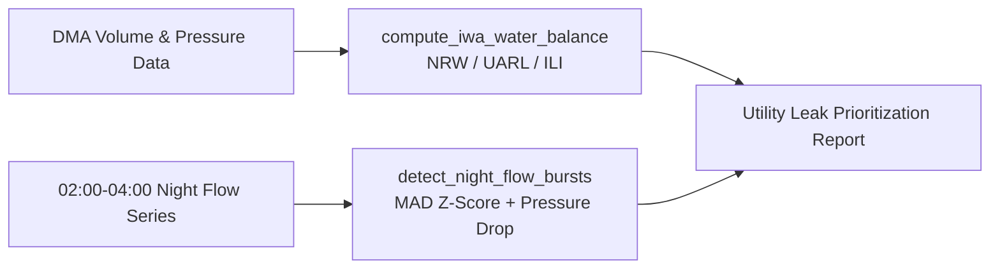

# watergrid-leak

[](https://github.com/codesphere-u/watergrid-leak/actions/workflows/ci.yml)
[](LICENSE)
[](pyproject.toml)
[](pyproject.toml)

**IWA Non-Revenue Water (NRW) balance auditor, Lambert UARL & Infrastructure Leakage Index (ILI) calculator, and rolling MAD Minimum Night Flow (MNF) pipe-burst detector.**

- **Mission Domain:** Water Security & Municipal Utilities
- **Stack:** Pure Python 3.11+ (zero runtime third-party dependencies, `mypy --strict`, `ruff`, `pytest`)
- **Maintainer:** Codesphere Innovations (U) Limited (`codesphere-u`)

---

## Problem Solved

Municipal and rural water utilities lose 35–55% of treated water to unmonitored pipe bursts and background leakage, lacking lightweight open-source IWA water-balance and night-flow burst tools.

## Key Features

- Exact IWA Standard Water Balance separating Non-Revenue Water, Apparent Losses, and Real Losses (`CARL`).
- Lambert et al. (1999) Unavoidable Annual Real Losses (`UARL`), Infrastructure Leakage Index (`ILI`), World Bank performance band classification, and annual direct cost valuation.
- Robust median/MAD Minimum Night Flow (02:00–04:00) + pressure-drop burst alerting (`detect_night_flow_bursts`).

## Architecture Overview



See [docs/architecture.md](docs/architecture.md) for module-level design details.

## Installation

```bash
git clone https://github.com/codesphere-u/watergrid-leak.git
cd watergrid-leak
uv sync --extra dev
```

Or install in editable mode with standard `pip`:

```bash
pip install -e ".[dev]"
```

## Quick Start (CLI)

```bash
watergrid-leak demo
```

## Quick Start (Python API)

```python
from watergrid_leak import DmaNetworkInput, compute_iwa_water_balance

rep = compute_iwa_water_balance(DmaNetworkInput("DMA-1", 1000.0, 600.0, 20.0, 32.0, 50.0, 2500, 40.0))
assert rep.ili == 3.0
```

## Testing & Quality Gates

```bash
uv run ruff check src tests
uv run mypy src
uv run pytest -v
```

## Security, Contributing & Roadmap

- **Security:** See [SECURITY.md](SECURITY.md) for responsible disclosure procedures.
- **Contributing:** See [CONTRIBUTING.md](CONTRIBUTING.md) and [CODE_OF_CONDUCT.md](CODE_OF_CONDUCT.md).
- **Changelog & Roadmap:** See [CHANGELOG.md](CHANGELOG.md) and [ROADMAP.md](ROADMAP.md).

## License

MIT License — see [LICENSE](LICENSE).

## Support & Contact

Open an issue on [GitHub Issues](https://github.com/codesphere-u/watergrid-leak/issues) or contact `codesphereinnovationz@gmail.com`.
